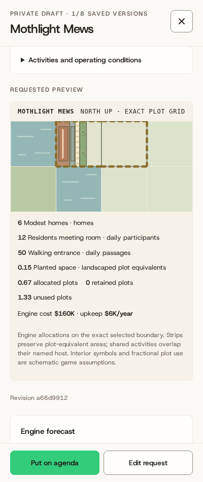
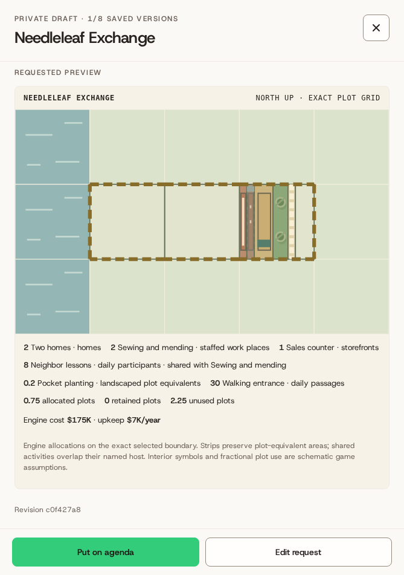
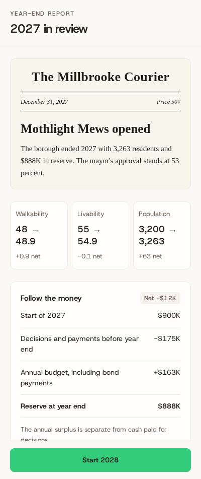
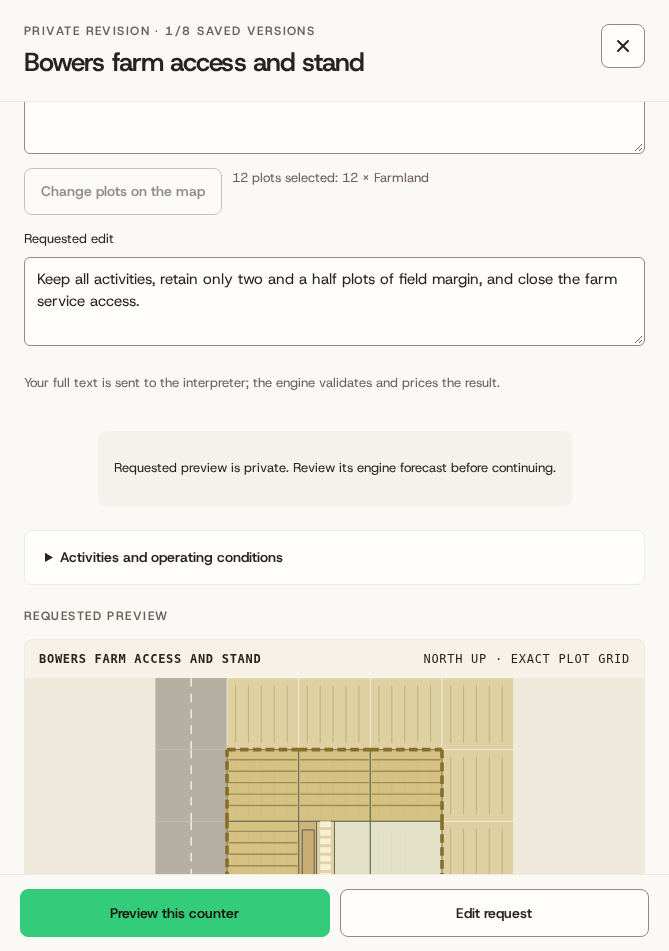
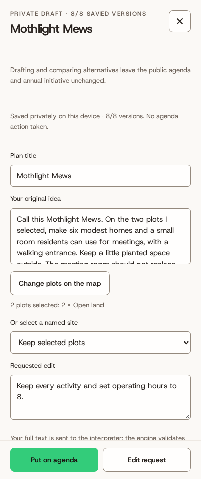
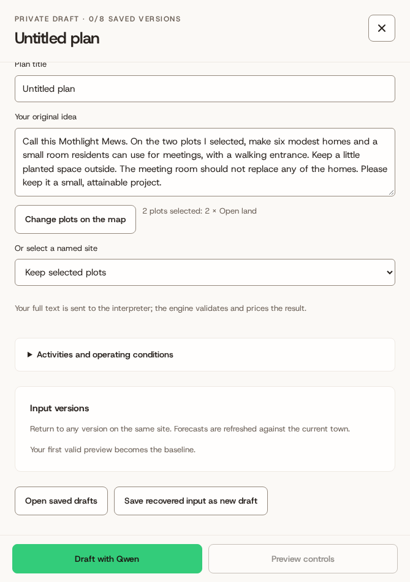
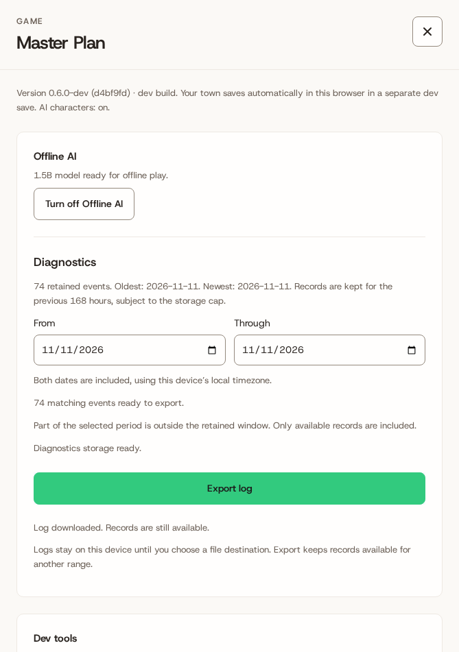
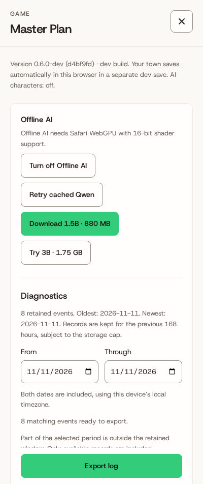
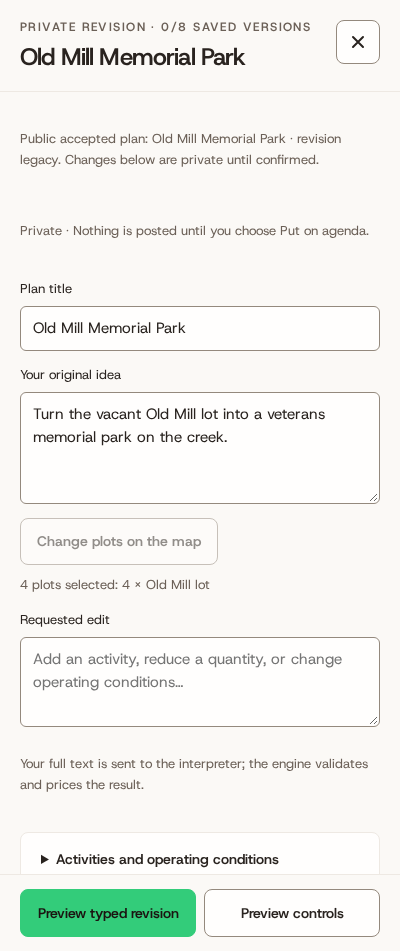

# Independent QA · candidate D

Exact source/reviewer target: `d4bf9fdf9d73ed0b48ac44ef0374b446fa20688d`. Contract C2.1.

Disposition: **needs revision: R11 exact diagnostic reason remains missing from export**. This report preserves C evidence and does not close the pending final-target gate.

Code/browser-fixture corpus: **12/12**, supported **8/8**; normal typed full lifecycles: **3/3**. Actual live generations: **0**.

Provider metadata, tokenizer, GPU feature and replies in fixture flows are synthetic. Native races use real Web Locks/storage/engine. Account callbacks are controlled. The real loader uses unchanged GPU reporting.

| Case | Original input | Result | Typed edits / repairs / omissions |
|---|---|---|---|
| S01 | Call this Mothlight Mews. On the two plots I selected, make six modest homes and a small room residents can use for meetings, with a walking entrance. Keep a little planted space outside. The meeting room should not replace any of the homes. Please keep it a small, attainable project. | pass | 3 / 0 / 0 |
| S02 | I want Copper Kite Fixery here: a little workplace with repair benches, secure storage for tools and parts, and evening repair lessons for neighbors using those same benches after work. Include a walking entrance. Start with four work places and a very small store. Count the lesson space as shared with the repair room, not a second building. | pass | 3 / 0 / 0 |
| S03 | Make Lantern Shelf Commons on my selected land: a compact public lending room with a separate small class and meeting space and an accessible walking entrance. Operate for eight hours a day. I need lending and classes to remain identifiable even if they use the same basic community-building type. | pass | 1 / 0 / 0 |
| S04 | This is Sunclock Play Yard: a small outdoor games area with a distinct patch for occasional neighborhood performances, a walking entrance and a planted edge. Keep the footprint modest across my selected plots, run activities for eight hours daily, and make any assumptions about attendance clear. | pass | 3 / 0 / 0 |
| S05 | Plan Thistle Loop Growers here: productive growing beds, a small produce stall and a tiny equipment shed, with the farm and service entrance kept usable. Leave some ground planted rather than covering the entire site. I want this to remain a working growing place, not just a decorative park or an ordinary shop. | pass | 1 / 0 / 0 |
| S06 | Use this land for Rainstep Link: a modest public walking route, a rain garden to manage runoff, and just a little visitor parking. Leave a small area of ordinary planting too. Show the route, drainage planting and parking separately; I am not requesting a bridge, a road expansion or a new building. | pass | 1 / 0 / 0 |
| S07 | Create Quiet Cargo Court as a very small daytime trading place with a public operating commitment: six hours open each day, daytime deliveries only, maintained service access and a planted buffer. Include the operating commitment in the actual plan so it still applies after construction. Do not treat those terms as decorative text. | pass | 1 / 0 / 0 |
| S08 | Call this Needleleaf Exchange. I want two homes, a small sewing and mending workplace, a little sales counter, and neighbor lessons that share the workroom after work. Keep a pocket of planted open space and a walking entrance. Use the selected land exactly and keep every one of those functions in a small scheme; the unfamiliar name is just its identity. | pass | 1 / 0 / 0 |
| A01 | Give these plots somewhere useful for people to gather, but I have not decided what kind of place or whether it should be indoors. Help me work that out before treating a particular use as my accepted plan. | pass | 0 / 0 / 0 |
| A02 | Make the activity space bigger and the other part smaller, but I mean the one I was thinking of rather than necessarily the one shown. I have not said which activity or how much space to transfer. Please check that with me. | pass | 0 / 0 / 0 |
| U01 | On this one selected plot, build five separate ground-level uses: homes taking the entire plot, a shop taking the entire plot, a community room taking the entire plot, a games field taking the entire plot and growing beds taking the entire plot. None may share space or be reduced, and do not acquire other plots. Explain the capacity problem rather than quietly fitting a smaller version. | pass | 0 / 0 / 0 |
| U02 | Build a reversible pumped-water power station on this plot that physically simulates reservoir levels, turbine output hour by hour, stored megawatt-hours and electricity sales under changing demand. Those energy and water-storage mechanics are essential, so a generic workplace with that name is not an acceptable substitute. Tell me what is not modeled and ask before proposing a reduced scope. | pass | 0 / 0 / 1 |

| Lifecycle | Viewport | Result | Accepted → delivered revision |
|---|---|---|---|
| S01 | 400×951 | pass | `877e6e4f61b9` → `877e6e4f61b9` |
| S02 | 669×951 | pass | `2148ba8825eb` → `2148ba8825eb` |
| S04 | 400×951 | pass | `a450f1dff84c` → `a450f1dff84c` |

| Assigned scope | Pass / total | Evidence type |
|---|---|---|
| nativeRaces | 8/8 | native storage/engine |
| personasCouncil | 5/5 | actual code with controlled fixtures; see JSON scope |
| councilNegativeBoundaries | 3/3 | actual code with controlled fixtures; see JSON scope |
| scopeAcknowledgment | 2/2 | actual code with controlled fixtures; see JSON scope |
| failureOfflineDiagnostics | 2/2 | actual code with controlled fixtures; see JSON scope |
| footerTouchStages | 4/4 | actual code with controlled fixtures; see JSON scope |
| accountFormatFences | 9/9 | actual code with controlled fixtures; see JSON scope |
| pendingRecovery | 2/2 | actual code with controlled fixtures; see JSON scope |
| loadRenderAccountValidation | 26/26 | actual code with controlled fixtures; see JSON scope |
| gridLoadRenderAccountValidation | 12/12 | actual code with controlled fixtures; see JSON scope |
| diagnosticBounds | 2/2 | actual code with controlled fixtures; see JSON scope |
| historyDiagnosticReason | 0/1 | actual code with controlled fixtures; see JSON scope |
| oldShellStable | 1/1 | actual code with controlled fixtures; see JSON scope |
| prunedOldCredit | 1/1 | actual code with controlled fixtures; see JSON scope |
| actualLoader | 4/4 loader checks; live blocked | actual GPU |
| softwareLoader | 4/4 loader checks; live blocked | actual GPU |

Pinned footer: 18/18 stages at 400×951 and 669×951 passed actual body-scroll/region-bound checks; rapid two-plot touch passed at both widths.

Recovery adjudication: the original selector and label mismatches are preserved. Structured rechecks verify identical accepted program, revision, layout, ordered plots, money, forecast values and SVG geometry while pending input remains recoverable and unpostable.

Gate-level outcomes, all 12 exact inputs, assertions, complete revision IDs, repair/omission counts, and raw artifact SHA-256 references are in [qa-summary.json](qa-summary.json). Raw repeated saves remain outside the repository.

Open external gates: actual downloaded Qwen inference (`shader-f16` unavailable), physical Duo airplane mode, and the real artifact/account host. Browser mocks do not close those gates.

The original candidate A first pass remains 1/12 raw and 9/12 adjudicated; no initial result has been rewritten.

Known findings on this candidate: R11-HISTORY-REASON reproduced on this exact target: engine retains zero credit but diagnostic export drops the exact fixed reason.

