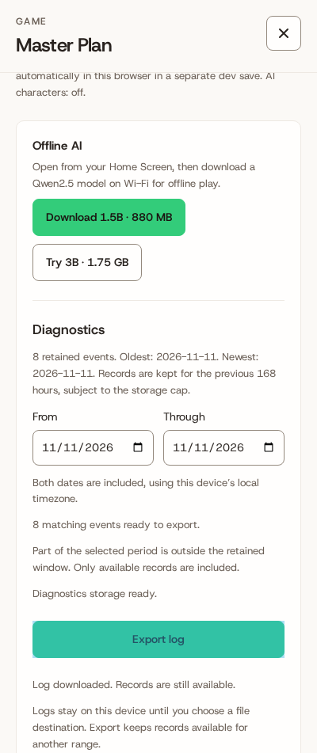
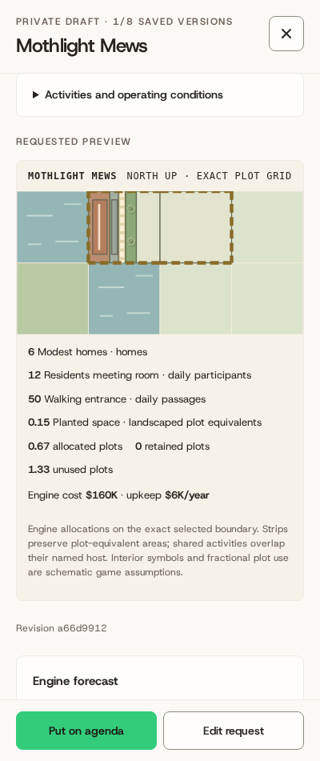
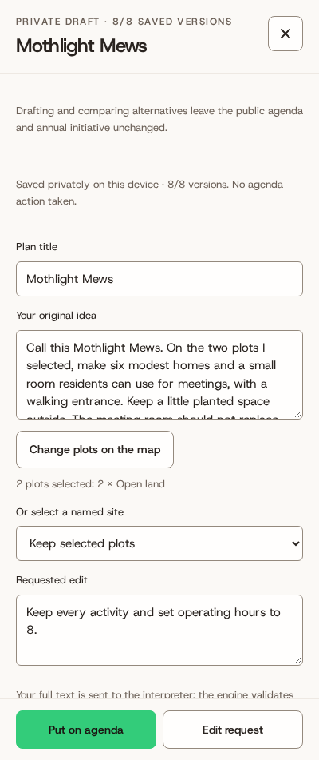

# Independent final QA · Candidate E

Integrated / designated Reviewer target: **`09f924bb305999932e8b74383f9d3f759f95895c`**. Contract C2.1 (`781a2491330e86cca15281437edc9ac3074a26e3`).

**Ready for the assigned controlled-code/browser QA gate.** No open QA product blocker. Live Qwen, physical Duo and the real artifact/account host remain external gates; AI-ready acceptance is not claimed.

All gameplay results below were observed at **D `d4bf9fdf9d73ed0b48ac44ef0374b446fa20688d`**. E adds one fixed diagnostics allowlist entry. Engine, UI, request/provider code, renderer, store, flags and build scripts are byte-identical. The coordinator authorized carrying D observations forward; this packet keeps their D source identity.

**Actual E checks: 4/4 pass** — conservative-history runner/export reason, normal Diagnostics download/privacy, actual Dev identity, actual Stable identity. The exact `claim_history_unresolved` reason survives; arbitrary private text does not. R11 is closed on E. E full suite **248/248**, zero failed/skipped, traceability green; both independently rebuilt channels match coordinator hashes.

| D evidence carried to E | Pass / total |
|---|---|
| Original corpus: 8 supported / 2 ambiguous / 2 infeasible or unmodeled | 12/12 |
| Normal typed full lifecycles: three edits, two alternatives, explicit post/funding/decision/delivery/reload | 3/3 |
| Native two-page shared-storage/Web Locks races | 8/8 |
| Persona/council scenarios | 5/5 |
| Irrelevant/hostile/narrative-offer council negatives | 3/3 |
| Nested/layout malformed load/render/account protection | 26/26 |
| Additional malformed grid metadata load/account protection | 12/12 |
| Account UI / format / channel / private-capacity checks | 9/9 |
| Footer suites plus rapid adjacent touch at 400/669 | 4/4 suites; 18/18 scroll stages |
| Pending invalid controls and ordered-site recovery | 2/2 widths |
| Explicit supported-scope acknowledgment | 2/2 widths |
| Failure/repair/recovery and cached-offline mock flow | 2/2 |
| 168-hour retention and local/DST export boundaries | 2/2 |
| Baseline old-shell and Stable namespace isolation | 1/1 |
| Authentic A pruned-credit protection | 1/1 |
| C→D function / valid-case / lifecycle equivalence | 28/28 |
| Real default + software GPU loader feedback | 8/8 capability checks; live inference blocked |

Provider replies, loaded metadata/tokenizer and GPU feature in typed fixture flows are synthetic. Native races use real engine/storage/Web Locks. Account callbacks are controlled. The separate actual loader has unmodified GPU reporting: default has no adapter; software Vulkan has an adapter without shader-f16. Both q4f16 models are blocked. **Zero live generations**; actual offline model weights and physical Duo were not available.

| Case | Exact original input | Result | Typed edits / repair generations / omissions |
|---|---|---|---|
| S01 | Call this Mothlight Mews. On the two plots I selected, make six modest homes and a small room residents can use for meetings, with a walking entrance. Keep a little planted space outside. The meeting room should not replace any of the homes. Please keep it a small, attainable project. | pass @ D | 3 / 0 / 0 |
| S02 | I want Copper Kite Fixery here: a little workplace with repair benches, secure storage for tools and parts, and evening repair lessons for neighbors using those same benches after work. Include a walking entrance. Start with four work places and a very small store. Count the lesson space as shared with the repair room, not a second building. | pass @ D | 3 / 0 / 0 |
| S03 | Make Lantern Shelf Commons on my selected land: a compact public lending room with a separate small class and meeting space and an accessible walking entrance. Operate for eight hours a day. I need lending and classes to remain identifiable even if they use the same basic community-building type. | pass @ D | 1 / 0 / 0 |
| S04 | This is Sunclock Play Yard: a small outdoor games area with a distinct patch for occasional neighborhood performances, a walking entrance and a planted edge. Keep the footprint modest across my selected plots, run activities for eight hours daily, and make any assumptions about attendance clear. | pass @ D | 3 / 0 / 0 |
| S05 | Plan Thistle Loop Growers here: productive growing beds, a small produce stall and a tiny equipment shed, with the farm and service entrance kept usable. Leave some ground planted rather than covering the entire site. I want this to remain a working growing place, not just a decorative park or an ordinary shop. | pass @ D | 1 / 0 / 0 |
| S06 | Use this land for Rainstep Link: a modest public walking route, a rain garden to manage runoff, and just a little visitor parking. Leave a small area of ordinary planting too. Show the route, drainage planting and parking separately; I am not requesting a bridge, a road expansion or a new building. | pass @ D | 1 / 0 / 0 |
| S07 | Create Quiet Cargo Court as a very small daytime trading place with a public operating commitment: six hours open each day, daytime deliveries only, maintained service access and a planted buffer. Include the operating commitment in the actual plan so it still applies after construction. Do not treat those terms as decorative text. | pass @ D | 1 / 0 / 0 |
| S08 | Call this Needleleaf Exchange. I want two homes, a small sewing and mending workplace, a little sales counter, and neighbor lessons that share the workroom after work. Keep a pocket of planted open space and a walking entrance. Use the selected land exactly and keep every one of those functions in a small scheme; the unfamiliar name is just its identity. | pass @ D | 1 / 0 / 0 |
| A01 | Give these plots somewhere useful for people to gather, but I have not decided what kind of place or whether it should be indoors. Help me work that out before treating a particular use as my accepted plan. | pass @ D | 0 / 0 / 0 |
| A02 | Make the activity space bigger and the other part smaller, but I mean the one I was thinking of rather than necessarily the one shown. I have not said which activity or how much space to transfer. Please check that with me. | pass @ D | 0 / 0 / 0 |
| U01 | On this one selected plot, build five separate ground-level uses: homes taking the entire plot, a shop taking the entire plot, a community room taking the entire plot, a games field taking the entire plot and growing beds taking the entire plot. None may share space or be reduced, and do not acquire other plots. Explain the capacity problem rather than quietly fitting a smaller version. | pass @ D | 0 / 0 / 0 |
| U02 | Build a reversible pumped-water power station on this plot that physically simulates reservoir levels, turbine output hour by hour, stored megawatt-hours and electricity sales under changing demand. Those energy and water-storage mechanics are essential, so a generic workplace with that name is not an acceptable substitute. Tell me what is not modeled and ask before proposing a reduced scope. | pass @ D | 0 / 0 / 1 |

| Lifecycle @ D | Viewport | Accepted → delivered revision |
|---|---|---|
| S01 | 400×951 | `877e6e4f61b9db49b10ba8bbce2bcf2500d8ae5d4f298186a17230a9383fd05f` → `877e6e4f61b9db49b10ba8bbce2bcf2500d8ae5d4f298186a17230a9383fd05f` |
| S02 | 669×951 | `2148ba8825eb5be89eb089abfe3f245738207c66b9beb79179d027528245171a` → `2148ba8825eb5be89eb089abfe3f245738207c66b9beb79179d027528245171a` |
| S04 | 400×951 | `a450f1dff84cdc5efb4eb21cada949d1d1b4af4e91123c2263f0fd6f90bc4c32` → `a450f1dff84cdc5efb4eb21cada949d1d1b4af4e91123c2263f0fd6f90bc4c32` |

Complete case programs/activities, edit inputs, revisions, money/allocation/omission details, assertion outcomes, evidence types and raw SHA-256 references are in [qa-summary.json](qa-summary.json). [coverage.json](coverage.json) maps all 34 rows and preserves Reviewer/Planner ownership. Raw multi-megabyte repeated saves remain outside the repository.

A's immutable first pass remains **1/12 raw, 9/12 adjudicated**. B and C initial/adjudicated attempts remain preserved. The C recovery selector returned null after the honest “Last accepted preview” relabel; structured rechecks separately verified accepted program/revision/layout/plots/prices/forecast/SVG equality and pending-input retention. The legacy park label mismatch was also a harness assertion; the actual label is “4 plots selected: 4 × Old Mill lot.” These original failures were not rewritten.

Planner owns sustained play and twelve-year strategies; Reviewer owns the extension and final code audit. Their records keep their own source SHAs. Final remote CI, merge, deployment and artifact publication belong to the coordinator. QA made no product-source changes.

Remaining device/live checks: [duo-checklist.md](duo-checklist.md).

